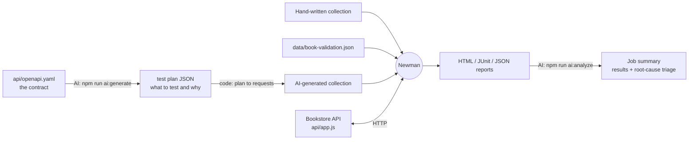

# API Automation with Newman + AI

[](https://github.com/RealOrji/API-Automation-Newman-/actions/workflows/api-tests.yml)
[](LICENSE)


An open-source learning project for **API test automation with Postman collections and Newman**, run in **GitHub Actions**, with **AI (Claude)** to generate tests from an OpenAPI spec and explain failures.

Everything you need is in this repo, including the API under test, so you can clone it and run the suite in under a minute. No accounts or keys are needed for the core suite.

---

## What you will learn

| Topic | Where to look |
|---|---|
| Writing Postman tests: `pm.test`, `pm.expect`, status, headers, body | [`collections/books-api.postman_collection.json`](collections/books-api.postman_collection.json) |
| Chaining requests (login → token, create → id) | the `Auth` and `Books - CRUD flow` folders |
| Collection-level auth and collection-level tests that run after every request | collection `auth` and `event` sections |
| JSON Schema contract checks with `pm.response.to.have.jsonSchema` | the `schema.book` / `schema.error` collection variables |
| Negative testing: auth, validation, 404, 409, malformed JSON | the `Books - Negative` folder |
| Data-driven testing with an iteration data file | [`collections/books-data-driven.postman_collection.json`](collections/books-data-driven.postman_collection.json) + [`data/book-validation.json`](data/book-validation.json) |
| Running Newman from Node.js and from the CLI | [`scripts/run-tests.js`](scripts/run-tests.js), the `newman-cli` CI job |
| HTML, JUnit and JSON reports | `reports/` after any run |
| Linting collections before running them | [`scripts/validate-collections.js`](scripts/validate-collections.js) |
| AI test generation from OpenAPI | [`ai/generate-tests.js`](ai/generate-tests.js) |
| AI root-cause triage of failed tests | [`ai/analyze-failures.js`](ai/analyze-failures.js) |
| CI/CD: matrix jobs, artifacts, job summaries, secrets, scheduled runs | [`.github/workflows/`](.github/workflows) |

---

## How it fits together



**The AI never writes test code.** Claude returns a structured *test plan* (the JSON format is fixed by a schema), and ordinary code in `ai/generate-tests.js` turns each planned case into a Postman request with `pm.test()` assertions. That keeps the generated collection predictable, and the plan file is short enough to review in a pull request.

---

## Quick start

Requirements: Node.js 22.9 or newer (the repo pins 24 in `.nvmrc`).

```bash
git clone https://github.com/RealOrji/API-Automation-Newman-.git
cd API-Automation-Newman-
npm install
npm test
```

`npm test` starts the sample API in-process on a free port, runs the regression collection with Newman, and writes reports to `reports/`. Open `reports/books-api.html` in a browser for the full report.

### All commands

| Command | What it does |
|---|---|
| `npm test` | Regression suite (25 requests, 100+ assertions) |
| `npm run test:smoke` | Only the `Health` folder: a fast smoke check |
| `npm run test:data` | Data-driven suite: one iteration per row of `data/book-validation.json` |
| `npm run test:generated` | Runs the AI-generated collection in `collections/generated/` |
| `npm run test:remote` | Runs the suite against an API that is already running (`BASE_URL`, default `http://localhost:3000`) |
| `npm start` | Starts the sample API on port 3000 (`PORT` to change) |
| `npm run lint` | Checks every collection: valid v2.1, `{{baseUrl}}` URLs, assertions present, no script syntax errors |
| `npm run ai:generate` | Asks Claude to plan tests from `api/openapi.yaml` and builds a collection (needs an API key) |
| `npm run ai:generate -- --dry-run` | Prints the exact prompt without calling the API |
| `npm run ai:generate:example` | Builds the generated collection from the bundled example plan (no key needed) |
| `npm run ai:analyze` | Summarises every report in `reports/`; asks Claude to triage failures if a key is set |

`scripts/run-tests.js` takes options too, for example:

```bash
node scripts/run-tests.js --collection collections/books-api.postman_collection.json --folder Auth --folder "Books - Read"
node scripts/run-tests.js --no-server --base-url https://staging.example.com
```

### Using Postman instead of the terminal

Import `collections/*.postman_collection.json` and `environments/local.postman_environment.json` into Postman, run `npm start`, select the **Local** environment and run the collection. The same tests run in both places.

---

## Project structure

```
.
├── api/
│   ├── app.js                    # Bookstore API (Express, in-memory data): the system under test
│   ├── server.js                 # starts it on PORT (default 3000)
│   └── openapi.yaml              # the API contract, input for AI test generation
├── collections/
│   ├── books-api.postman_collection.json          # hand-written regression suite
│   ├── books-data-driven.postman_collection.json  # data-driven validation suite
│   └── generated/                                 # output of the AI generator
├── environments/
│   └── local.postman_environment.json
├── data/
│   └── book-validation.json      # iteration data: one validation case per row
├── ai/
│   ├── generate-tests.js         # OpenAPI → Claude test plan → Postman collection
│   ├── analyze-failures.js       # Newman report → results table + Claude triage
│   ├── lib/claude.js             # Anthropic SDK wrapper (model, structured output, errors)
│   └── examples/test-plan.example.json
├── scripts/
│   ├── run-tests.js              # Newman Node API runner with reporters
│   └── validate-collections.js   # collection linter
└── .github/
    ├── workflows/api-tests.yml          # CI: lint → Newman matrix → reports + summary
    ├── workflows/ai-generate-tests.yml  # manual: generate tests with Claude, optional PR
    └── dependabot.yml
```

---

## The API under test

A small Bookstore API. Data lives in memory, so each run starts from the same seed books.

| Method | Path | Auth | Notes |
|---|---|---|---|
| GET | `/health` | – | `{ status: "ok", uptime }` |
| POST | `/auth/token` | – | `admin` / `password123` → `{ token, tokenType, expiresIn }` |
| GET | `/books?author=&limit=` | – | `{ count, data: Book[] }` |
| GET | `/books/:id` | – | 404 if missing |
| POST | `/books` | Bearer | 201 + `Location`; 400 on validation, 409 on duplicate ISBN |
| PATCH | `/books/:id` | Bearer | partial update |
| DELETE | `/books/:id` | Bearer | 204 |
| POST | `/test/reset` | – | restore seed data (disabled when `NODE_ENV=production`) |

Errors always look like `{ "error": "Bad Request", "details": ["..."] }`. The full contract is in [`api/openapi.yaml`](api/openapi.yaml).

---

## AI-driven testing

Both AI scripts use the official Anthropic SDK ([`@anthropic-ai/sdk`](https://www.npmjs.com/package/@anthropic-ai/sdk)) with the `claude-opus-5-5` model by default. Set `CLAUDE_MODEL` to use another one.

### 1. Generate tests from the OpenAPI spec

```bash
cp .env.example .env              # then put your key in .env
npm run ai:generate
npm run test:generated
```

What happens:

1. The spec and a prompt (see it with `--dry-run`) go to Claude, with a JSON Schema for the reply ([structured outputs](https://platform.claude.com/docs/en/build-with-claude/structured-outputs)), so the answer is always valid, parseable JSON.
2. Each test case in the plan says what to call, with what auth and body, the expected status, and a few assertions from a small fixed list (`jsonPathEquals`, `headerContains`, ...), plus a one-line *rationale*.
3. The script adds a fixed `Setup` folder (reset, login, create a fixture book) and builds the collection.
4. The raw plan is saved next to the collection as `*.plan.json` so reviewers can read what is tested and why.

No key? `npm run ai:generate:example` builds the same kind of collection from [`ai/examples/test-plan.example.json`](ai/examples/test-plan.example.json), a **hand-written** example in the exact format Claude returns. The collection committed in `collections/generated/` was built from that example.

### 2. Triage failures

```bash
npm test || npm run ai:analyze
```

`ai:analyze` reads every Newman JSON report in `reports/` and always writes a results table. When there are failures and a key is set, it sends each failure (the request, the response, the failed assertion and the test script) together with the OpenAPI contract to Claude. Claude labels each root cause as **API bug**, **Test bug** or **Environment** and suggests a fix. The output goes to `reports/ai-analysis.md` and, in CI, to the job summary page.

Try it: change an expected value in a test (for example `to.eql(24.5)` → `to.eql(25)` in *Update the price*), run `npm test`, then `npm run ai:analyze`.

> AI output is a starting point, not a verdict. Read the generated plan before merging it, and check the triage against the evidence.

---

## CI/CD with GitHub Actions

### `api-tests.yml` runs on every push to main, every pull request, daily at 06:00 UTC, and on demand

```
lint ──┬── newman (regression)    ─┐
       ├── newman (data-driven)    ├─ reports uploaded as artifacts + results in the job summary
       ├── newman (ai-generated)  ─┘
       └── newman-cli (plain CLI against a server started in the job)
```

- **lint** fails fast on broken collections before any test runs.
- **newman** is a matrix with `fail-fast: false`, so one failing suite doesn't hide the others.
- Every job uploads `reports/` (HTML, JUnit, JSON) as a downloadable artifact.
- The *Summarise results* step writes a results table to the run's summary page. If the `ANTHROPIC_API_KEY` secret is set and something failed, Claude's triage appears there too. Without the secret the step still runs and just skips the AI part, so forks and first-time contributors get a green, useful pipeline.
- **newman-cli** shows the pattern for testing a deployed environment: start the service, wait for `/health`, run `npx newman run ...`.

### `ai-generate-tests.yml` runs manually from the Actions tab

It generates a fresh collection with Claude, lints it, runs it, triages failures, uploads everything, and (optionally) opens a pull request with the new collection and plan. It is manual on purpose, because each run calls a paid API.

### Setup for your fork

1. **Settings → Secrets and variables → Actions → New repository secret**: `ANTHROPIC_API_KEY` (get one at [platform.claude.com](https://platform.claude.com/)). Optional: the core pipeline runs without it.
2. To let the generator open pull requests: **Settings → Actions → General → Workflow permissions →** allow GitHub Actions to create and approve pull requests.

---

## Test your own API

1. Replace `api/openapi.yaml` with your spec and set `baseUrl` in a new environment file.
2. Run `npm run ai:generate -- --dry-run` and adjust the prompt in `ai/generate-tests.js` (the *Setup* steps describe this sample API's login and reset; change them to match yours).
3. Run `npm run test:remote` with `BASE_URL` set to your service, or add an environment file and pass `--environment`.
4. In CI, replace the in-process server with your deployment URL and keep secrets such as passwords in GitHub secrets, passed with `--env-var`.

---

## Exercises

1. Add a test that `GET /books?author=` with no match returns `count: 0` and an empty array.
2. Add a data row to `data/book-validation.json` for a title made only of spaces. Does the API handle it?
3. Introduce a bug in `api/app.js` (for example, return 200 instead of 201 on create) and watch which tests catch it.
4. Add a `staging` environment file and run the suite against it with `--environment`.
5. Add a new assertion kind to the generator (for example `jsonPathMatches` for a regex) and describe it in the prompt.

---

## Notes

- `npm audit` reports advisories in Newman's own dependency tree (`postman-runtime`, `handlebars`, `faker`). Newman is a dev dependency used to run tests, and it is not part of the API. Track [postmanlabs/newman](https://github.com/postmanlabs/newman) for updates; Dependabot is enabled for this repo.
- The demo credentials (`admin` / `password123`) only exist in the sample API. Never commit real credentials in environment files.

## Contributing

Issues and pull requests are welcome. See [CONTRIBUTING.md](CONTRIBUTING.md).

## License

[MIT](LICENSE) © Orji Innocent
